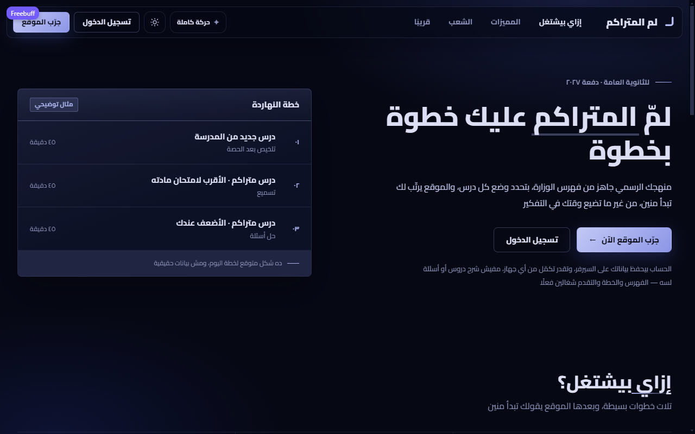
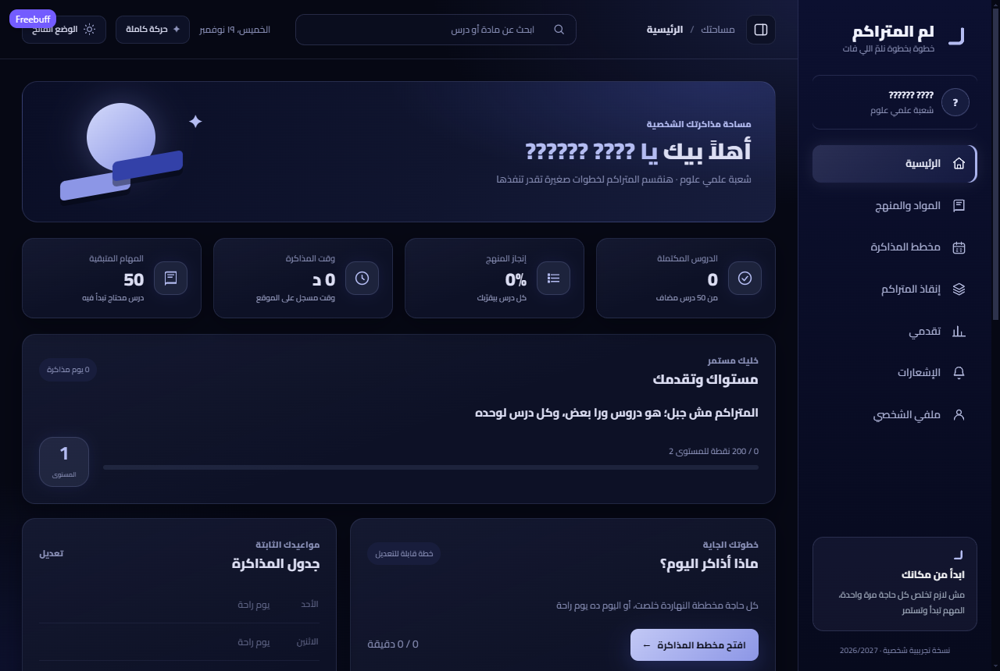
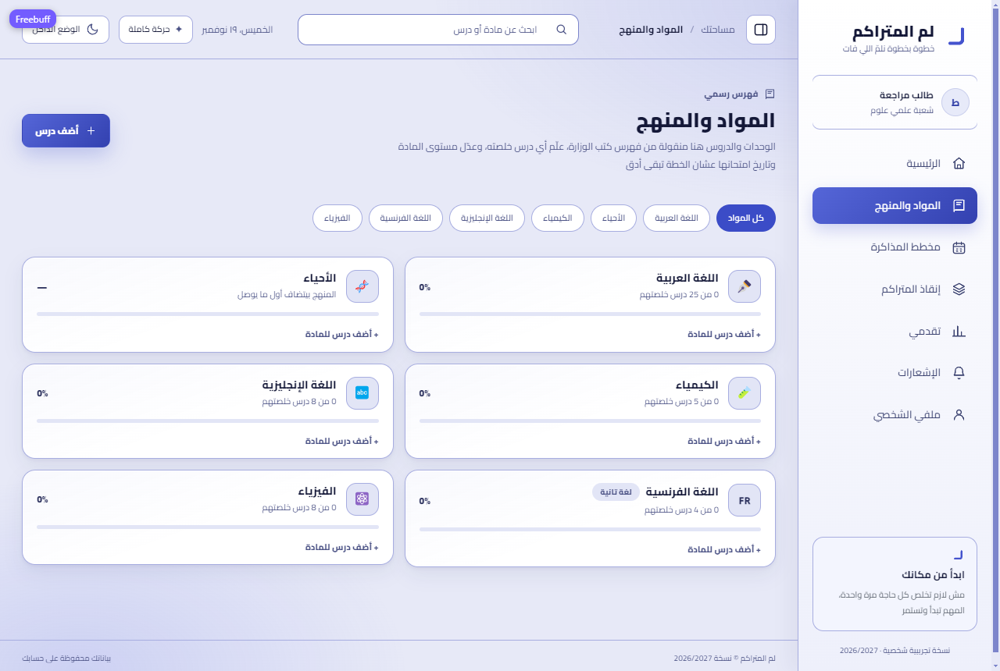
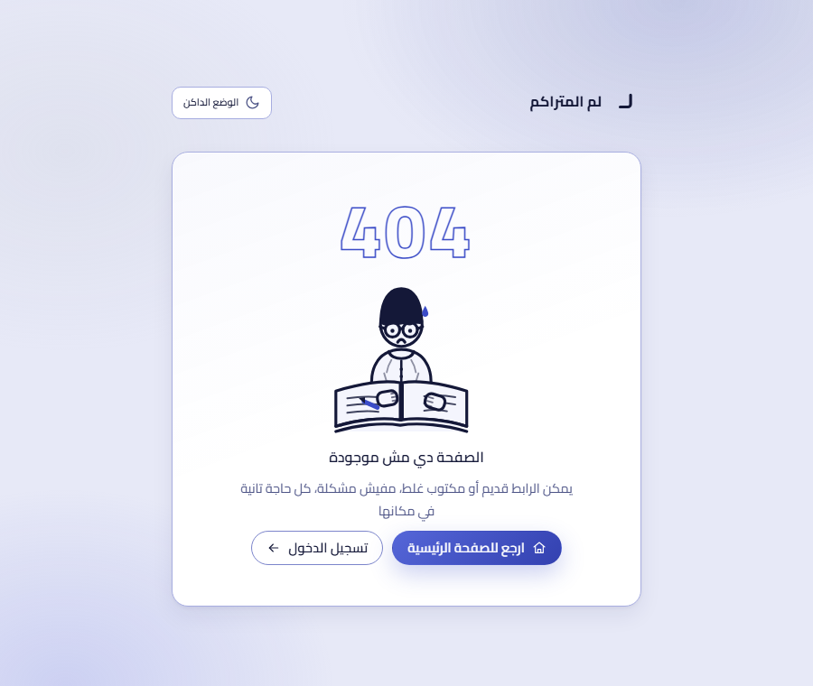

# لم المتراكم

منصة عربية (RTL) لطالب تالتة ثانوي مصري — بتجاوب على سؤال واحد: **أذاكر إيه النهاردة؟**

الفكرة إن الدروس الجديدة اللي المدرسة بتنزّلها باينة، والقديم اللي ما اتذاكرش بقى «متراكم». الموقع بياخد وقتك الحقيقي في اليوم،
وتاريخ امتحانك، ووضع كل درس، ويطلّع **خطة إنقاذ**: الجديد بيتحط في أيامه عشان ما يتراكمش، والمتراكم بياخد الباقي، ولو الوقت مش كفاية بيقولك
بصراحة إنه مش كفاية بدل ما يجمّل الصورة.

## اللي موجود فعلاً

- **المنهج**: فهرس الوزارة الرسمي — ١٦ مادة، ٤٦ وحدة، ١٤٣ درس. مفيش شرح دروس ملفّق؛ الفهرس بس بأرقام صفحات الكتب.
- **الحساب**: تسجيل/دخول/خروج، جلسات على السيرفر بتوكن، كلمة السر بـ `scrypt`، حدود محاولات، صورة بروفايل لحد ٢٠٠ كيلوبايت.
- **الواجهة**: React 19 + Vite 7، صفحات: الرئيسية، المواد، المخطط، المتراكم، تقدمي، الإشعارات، الملف الشخصي، الدخول، 404.
- **الثيم**: هوية «Pure Black + Silver» افتراضي (غامق/فاتح)، وبالِتات اختيارية (`indigo` / `teal`) على نفس التوكِنز.
- **الحركة**: `IntersectionObserver` للظهور في الاتجاهين، احترام `prefers-reduced-motion`، وسويتش «حركة كاملة / مخففة».
- **اختبارات السيرفر**: ٣٦ ناجح، ١ متخطّى (اختبار PostgreSQL الحقيقي محتاج `TEST_DATABASE_URL`).

## الناقص

- الاختبارات/التقييم (بنك أسئلة + محرك تصحيح).
- مكتبة مواد تعليمية (شرح وموارد)، مش فهرس بس.
- استرجاع كلمة السر وتأكيد الإيميل (محتاجين مزوّد إيميل).
- `pgStore` مكتوب ومُراجَع، بس ما اتجرّبش على PostgreSQL حقيقي في بيئة التطوير.

## بنية المشروع

```
app/
  server/    Node.js خام + pg (من غير فريم ورك) — REST API + خطة الإنقاذ + الاختبارات
    src/         app.js (الراوتس) · rescuePlan.js (محرك الخطة) · stores/ (memory + pg)
    db/          schema.sql · seed.sql
    test/        api · rescuePlan · store contract
  shared/    curriculum.json — فهرس المنهج
  web/       React 19 + Vite 7
    src/         pages/ · components/ · motion.jsx · theme.jsx · *.css
```

## التشغيل

### السيرفر
```bash
cd app/server
npm install
npm start          # :3000 — بيانات في الذاكرة، بتتمسح مع كل تشغيل
npm test           # كل الاختبارات
```

بقاعدة بيانات حقيقية (Neon / Supabase / أي PostgreSQL 13+):
1. نفّذ `db/schema.sql` مرة واحدة، وبعده `db/seed.sql`.
2. حط رابط الاتصال في `DATABASE_URL` (شوف `.env.example`).
3. `npm start`، ولاختبار الـ pg store: `TEST_DATABASE_URL=... npm test`.

### الواجهة
```bash
cd app/web
npm install
npm run dev        # :5173
npm run build
```
`VITE_API_URL` بيحدد عنوان الـ API (الافتراضي `http://localhost:3000`).

## صور

| الصفحة الرئيسية | الداشبورد |
| --- | --- |
|  |  |

| المواد (فاتح) | 404 + الشخصية |
| --- | --- |
|  |  |

الشخصية اترسمت من جديد (الكتلة الفاضية ← بلوفر بياقة وأزرار وخطوط قماش وإيدين بصوابع):


## ملاحظات

- التوكن في `localStorage` مش كوكي، فأي XSS في الواجهة يسرقه — الواجهة مبنية بحذر، بس ده قرار له تكلفة.
- حد المحاولات في ذاكرة السيرفر: بيتصفّر مع إعادة التشغيل ومش مشترك بين النسخ.
- ملفات الـ PDF للكتب الرسمية وحزم الـ ZIP مش مرفوعة في الريبو (حجمها كبير) — الريبو فيه الكود والبيانات المستخرجة منه.
